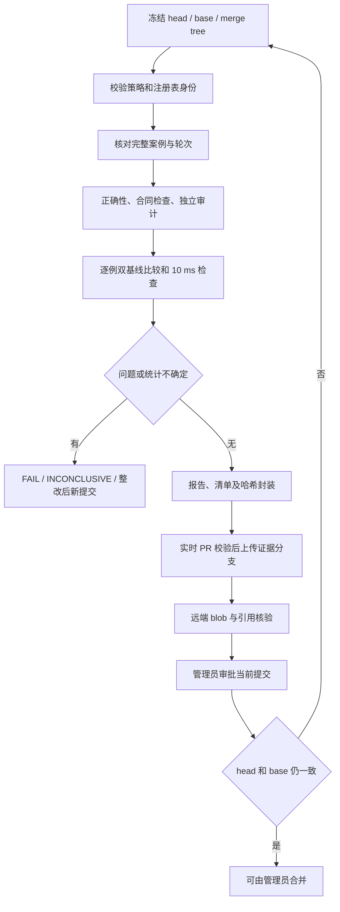
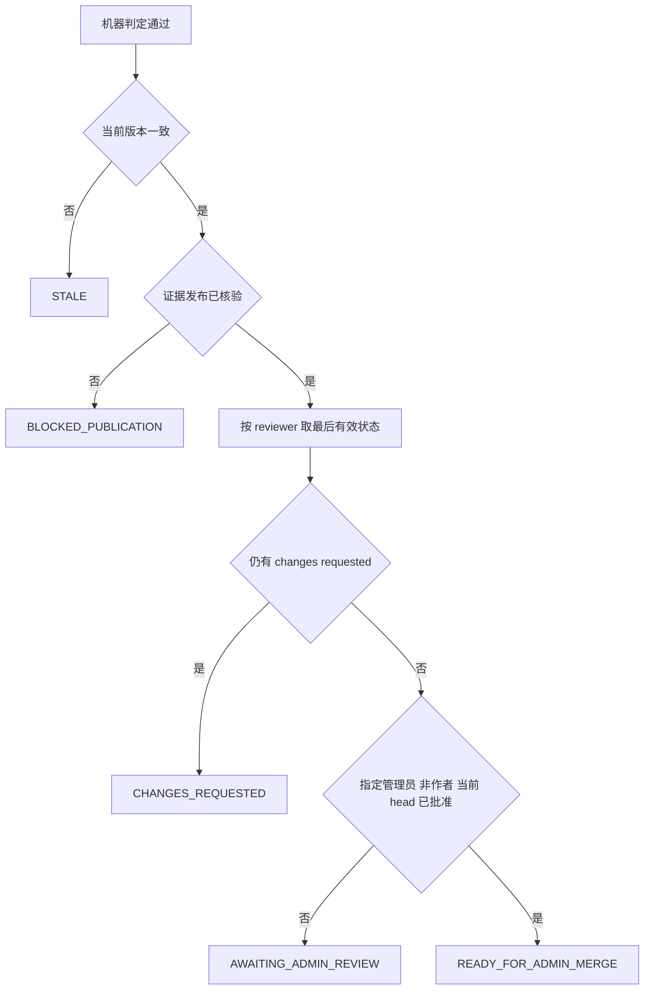

# 闭环验证协议的实现与算法路径

2026-10-26，实验框架，所有本轮案例为合成协议输入。实际几何算法和性能未测试。

## 模块与入口

| 模块 | 实现 | 输入 → 输出 |
| --- | --- | --- |
| 规则判定 | `tests/closed_loop/gate.py::evaluate` | 受信任策略、基线注册表、证据、实时上下文 → PASS/FAIL/INCONCLUSIVE 或 SIMULATION 前缀状态 |
| 性能比较 | `ratio_interval` | 配对原始时间 → 中位耗时比及 bootstrap 区间 |
| 审批状态机 | `merge_decision` | 判定、当前版本、发布回执、review 列表 → 待发布/待管理员/可由管理员合并/失效 |
| 演练与封装 | `run.py::smoke/verify` | 当前版本标识 → 合成记录、报告、清单和完整性校验 |
| 远端发布 | `github_bridge.py` | PR 与合成证据包 → 只追加证据提交、dry-run 状态及回执 |

## 执行路径

实验运行在结果前添加 `SIMULATION_`，`production_eligible=false`。发布状态固定为 `closed-loop/dry-run`，没有写正式成功检查或执行 merge 的入口。正式模式还必须通过开关、批准基线和可信执行器条件。

## 判定与统计

令 `a_i,k`、`b_i,k`、`c_i,k` 分别为案例 i 第 k 次冻结基线、当前主分支和候选耗时，单位 ms。主要度量是完整 API 冷上下文真实耗时；分段计时仅作诊断。

对每个旧案例分别计算 `median(c_i)/median(a_i)` 和 `median(c_i)/median(b_i)`。以相同索引重采样两组的配对轮次，固定种子 20261026，2000 次 bootstrap，取 2.5% 与 97.5% 分位。上界 ≤1.05 为满足相对门槛，下界 >1.05 为确定退化，跨线为 INCONCLUSIVE。按全部案例和 group 累加每例中位时间，另检查比值，防止错误分组掩盖退化。新案例检查 `max(c_i) < 10`。

相同数据与规则产生相同判定；环境有效性必须由可信采集器判断，统计函数不自动删去慢样本。逐例置信区间不代表整个数据集同时具备 95% 覆盖概率，也不代表未来请求硬实时达标。

## 几何合同与数据可信度

`contract` 指定必须提供的检查项。母面合同必须包含 surface_distance、boundary_position、uv_joint_tangent 及独立审计；数字界必须有限、非负且严格小于 1e-5/0.1°。其他合同保留自己的检查范围，由可信适配器产生已审计的检查结论；本判定器不重新实现几何证书。

一般兜底明确使用 interior_sample，不能自动升级为连续全域证书。精确认识、参数对应和母面联合切向合同互不替代。缺少必要字段、合同不匹配、退休入口、重复或遗漏数据直接失败。

`policy_sha256`、`registry_sha256`、输入/参数/环境 SHA256 与 head/base/merge tree 共同绑定证据。规范 JSON 的哈希用于结构身份，文件清单的 SHA256 用于包完整性；Git blob SHA 用于上传后逐文件核对。哈希不证明可信来源，因此未来正式控制器必须独立认证生产者，并且不能读取 PR 自改门槛。

## 审批子流程

评论不等于批准；DISMISSED 清除批准；旧提交批准失效；函数仅输出建议状态，不执行合并。GitHub 分支保护负责最终强制约束。演练函数使用显式合成 reviewer 事件，不会提交真实 review。

## 演练案例及边界

`run.py::fixture` 创建两个虚构案例：旧案例 4.00 → 4.04 ms、新案例 6.00 ms，各 20 条记录。它们只用于确认 PASS 分支，不是本项目性能测量。故障注入将旧案例改为 4.24 ms、将新案例一轮改为 10 ms、删除记录、改变 head/base、移除审计或改成错误接受，均应阻断；波动跨越 5% 时应返回 INCONCLUSIVE。

封装演练验证待上传、待批准、模拟批准、base 变化失效，并验证即使把 mode 改为 production，关闭开关与未批准基线仍拒绝。真实远端上传后按不可变提交链接审阅，源分支不会因报告发布而变动。

工程依赖为 Python 标准库和 GitHub API。现有 C++ 算法、容差、数据与 SDK 无变更。正式隔离执行器、全量基线和真实管理员审批没有在本轮运行，影响与激活条件见[运行规范](../requirements/CLOSED_LOOP_VALIDATION.md)。
